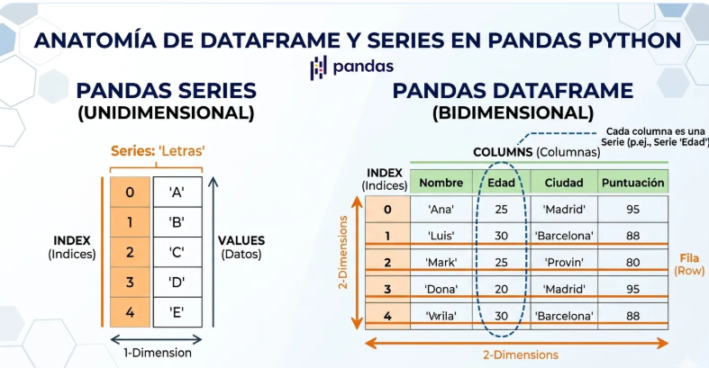
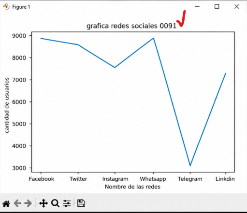
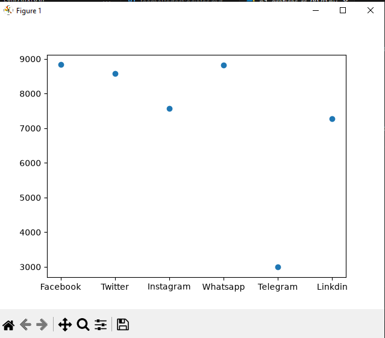
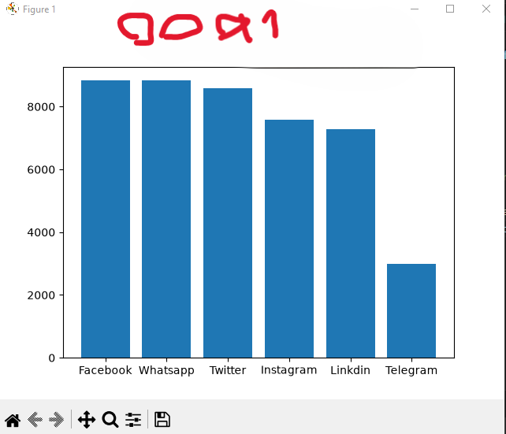
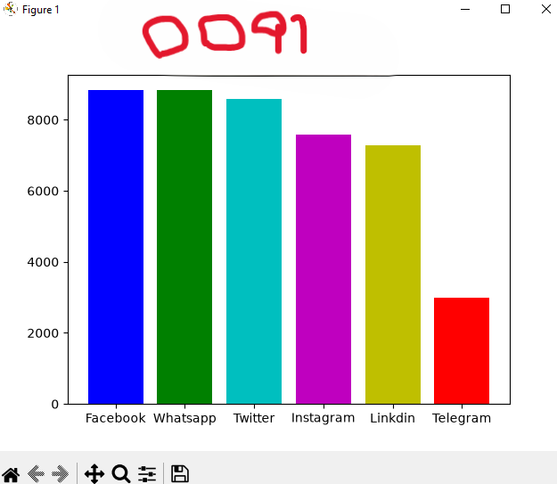
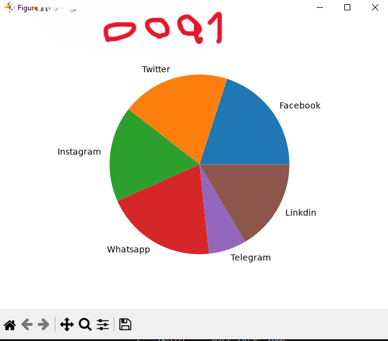

## Dataframe o marco de datos pandas

## redes sociales a nivel mundial

## grafica de redes sociales

## grafica puntos de redes sociales

## grafica de barras de redes sociales

## grafica de barras del mas grande al mas chico

## coloreando la grafica

## grafica de pastel o pie
